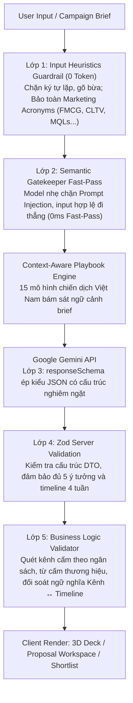

# MarketingAI — AI Marketing Strategy Workspace 🚀

> **Hệ thống trợ lý AI hỗ trợ doanh nghiệp, Marketers và Solo Creators hoạch định chiến lược Marketing toàn diện theo ngân sách thực tế.** Tự động sinh ý tưởng, timeline triển khai 4 tuần, phân bổ ngân sách Zero-Drift, ma trận dự phóng KPI phễu và xuất hồ sơ đề xuất họp Ban Giám Đốc (Meeting-Ready Proposal) chuẩn A4 / Word (.docx).

[](https://nextjs.org/)
[](https://www.typescriptlang.org/)
[](https://tailwindcss.com/)
[](https://ai.google.dev/)
[](LICENSE)

🌐 **Demo trực tuyến**: [marketing-ai-support.vercel.app](https://marketing-ai-support.vercel.app)

---

## 🌟 Điểm nổi bật & Lợi ích

- 🎯 **Định hướng ngân sách thực chiến**: Đề xuất không sáo rỗng, bám sát 03 mức ngân sách (Thấp: < 20M, Trung bình: 20M–100M, Cao: > 100M VNĐ), tự động loại trừ kênh tiếp thị quá tầm chi trả (không đề xuất TVC/Billboard lớn cho ngân sách thấp).
- 📑 **Hồ sơ đề xuất 1 trang chuẩn CMO ("Meeting-Ready Proposal")**: Chuyển đổi ý tưởng thành bản trình bày cấp cao gồm: Banner duyệt chi, phân bổ tài chính Zero-Drift `±500.000 VNĐ`, ma trận KPI 3 kịch bản (*Thận trọng, Cơ sở, Tích cực*), Checklist hành động Pre-launch (D-5 đến D-1) và Kế hoạch dự phòng Plan B.
- ⚡ **Tối ưu chi phí & Tốc độ Token**: Tích hợp cơ chế lọc đầu vào **Input Guardrail 2 lớp** (Lớp 1 Heuristics lọc rác 0 Token; Lớp 2 Semantic Gatekeeper Fast-Pass) tiết kiệm đến 95% token và phòng chống Prompt Injection.
- 🔒 **Quyền riêng tư & Self-host thân thiện**: Toàn bộ dữ liệu chiến dịch và Shortlist được lưu trữ trực tiếp trên trình duyệt (`localStorage` & `sessionStorage`). Không yêu cầu database phức tạp, chỉ cần clone về máy, nhập API Key và chạy ngay.
- 🛡️ **Độ bền bỉ cao (Zero White-Screen)**: Cơ chế **Smart Model Failover** tự động luân chuyển model khi Google quá tải (503 High Demand) kết hợp Fallback Mock chuyên sâu đa ngành, đảm bảo ứng dụng không bao giờ bị gián đoạn.

---

## 📸 Trải nghiệm giao diện & Tính năng chính

### 1. Luồng nhập thông tin tiếp thị thông minh (3-Step Wizard)
- **Bước 1: Sản phẩm & Ngành hàng**: Hỗ trợ chip gợi ý ngành hàng nhanh, bộ nhận diện thuật ngữ tiếp thị (FMCG, SaaS, F&B, DNVB...).
- **Bước 2: Mục tiêu chiến dịch**: Awareness, Leads, Sales, Rebranding hoặc Khởi chạy sản phẩm mới.
- **Bước 3: Ngân sách & Hồ sơ thương hiệu**: Tùy biến giọng điệu thương hiệu (3 tính từ brand tone), định vị khẳng định và các từ ngữ cấm kỵ.
- **Nút "Điền thử mẫu" (Prefill Presets)**: Điền mẫu 1 chạm cho 3 ngành thực tế (F&B, Thời trang, SaaS).

### 2. Gợi ý 05 ý tưởng chiến dịch marketing đa chiều
- Mỗi ý tưởng tuân thủ cấu trúc **Logic Marketing 5 thành phần**: Nhu cầu/rào cản tâm lý $\rightarrow$ Lợi ích & bằng chứng $\rightarrow$ Cơ chế đòn bẩy $\rightarrow$ Lời kêu gọi hành động (CTA) $\rightarrow$ Điều kiện thành công.
- **Timeline triển khai 04 tuần** chi tiết từng hành động cụ thể từ Tuần 1 đến Tuần 4, đồng bộ ngữ nghĩa với danh sách kênh tiếp thị đề xuất.
- **Bố cục thẻ 3D xếp chồng (WACT 3D Stacked Deck)**: Hiển thị trọn vẹn 5 ý tưởng trong một khung nhìn (viewport), lật trang mượt mà bằng chuột, thanh Jump Tabs `#1 - #5` hoặc **phím mũi tên (`←` / `→`)**.

### 3. Bộ hồ sơ chiến dịch "Meeting-Ready Campaign Proposal"
- **Executive Decision Banner**: Tóm tắt quyết định duyệt chi, tự động cảnh báo lệch ngân sách real-time.
- **Trình phân bổ ngân sách Zero-Drift**: Tinh chỉnh trực tiếp số tiền từng hạng mục qua nút `±500.000 VNĐ` kèm nút tự động cân bằng số dư vào Quỹ dự phòng rủi ro.
- **Ma trận dự phóng KPI 3 kịch bản**: Bóc tách theo đúng mục tiêu (Awareness tính Reach/CPM; Sales/Leads tính chuỗi phễu chuyển đổi), minh bạch 3 nguồn gốc dữ liệu (`user_provided`, `system_calculated`, `assumed`).
- **Xuất bản in ấn & PDF chuẩn A4 1 trang**: Công nghệ CSS `@media print` isolation bảo toàn tỷ lệ A4, màu sắc dải phân bổ và chống ngắt trang lộn xộn.
- **Xuất báo cáo Word chuyên nghiệp (.docx)**: Tạo file Word chuẩn nhị phân phía client với bảng biểu sắc nét.

### 4. Công cụ hỗ trợ ra quyết định nâng cao
- **AI Conversational Refinement**: Tinh chỉnh một ý tưởng cụ thể bằng ngôn ngữ tự nhiên (đổi kênh, giảm ngân sách, chỉnh slogan...) kèm chế độ xem so sánh thay đổi (Diff View).
- **AI Strategy Comparison & CMO Verdict**: Chọn 2–3 ý tưởng để so sánh đối đầu đa tiêu chí, trợ lý AI CMO chỉ ra phương án chiến thắng (`Winner`), điểm mù (`Blind spots`) và kịch bản phối hợp Hybrid.
- **Evidence Grounding Engine**: Đối chiếu ý tưởng với 08 Case Study thực tế tại Việt Nam hoặc tự động sinh **Kế hoạch thử nghiệm nhỏ (Mini-Experiment)** 3–5 ngày với chi phí thấp khi chưa có tiền lệ.
- **Trang Quản lý Shortlist (`/shortlist`)**: Lưu trữ ý tưởng yêu thích, sao chép nhanh tóm tắt dạng bullet points gửi sếp hoặc đồng đội qua Zalo/Slack/Email.

---

## 🛠️ Công nghệ sử dụng

| Lớp | Công nghệ | Chi tiết |
|---|---|---|
| **Frontend Framework** | React 18, Next.js 14+ (App Router) | Server-side Rendering & Route Handlers |
| **Styling & Icons** | Tailwind CSS 3.4, Lucide React | Giao diện tối hiện đại, responsive mobile 375px+ |
| **AI SDK & Model** | `@google/genai` (^2.32.0) | Hỗ trợ Google Gemini 3 Flash / 3.5 Flash Lite |
| **Validation & Schema** | Zod (^3.24.2) | Xác thực dữ liệu Form & ép kiểu JSON phản hồi từ AI |
| **File Export** | `docx` (^9.15.3) & `@media print` CSS | Xuất file Word Office Open XML & In PDF A4 1 trang |
| **Lưu trữ & State** | Client Storage (`localStorage`, `sessionStorage`) | Không cần database, bảo mật dữ liệu cục bộ |

---

## 🛡️ Quy trình kiểm soát chất lượng & an toàn 5 lớp

Hệ thống áp dụng kiến trúc phòng thủ đa tầng để đảm bảo phản hồi AI luôn chính xác, không ảo giác, an toàn trước Prompt Injection và tối ưu hóa chi phí token:



---

## 🚀 Hướng dẫn Cài đặt & Khởi chạy (Quick Start)

### Yêu cầu tiên quyết
- **Node.js**: Phiên bản 18.x trở lên (khuyên dùng Node.js 20.x LTS hoặc 24.x).
- **Khóa API Google Gemini**: Đăng ký và lấy API Key hoàn toàn miễn phí tại [Google AI Studio](https://aistudio.google.com/).

### Các bước cài đặt

```bash
# 1. Clone repository về máy cá nhân
git clone https://github.com/ngtkhanh/Marketing_AISupport.git
cd Marketing_AISupport

# 2. Cài đặt các gói phụ thuộc
npm install

# 3. Thiết lập biến môi trường
cp .env.example .env.local
```

Mở file `.env.local` và điền khóa API của bạn:

```env
GEMINI_API_KEY=AIzaSy...your_gemini_api_key_here
GEMINI_MODEL=gemini-3.5-flash-lite
GEMINI_GUARD_MODEL=gemini-3.5-flash-lite
```

```bash
# 4. Chạy ứng dụng ở môi trường phát triển
npm run dev
```

Mở trình duyệt và truy cập: **`http://localhost:3000`**

### Kiểm tra bản Build Production

```bash
npm run build
npm run start
```

---

## ⚙️ Cấu hình biến môi trường

| Biến môi trường | Bắt buộc | Mặc định | Mô tả |
|---|:---:|---|---|
| `GEMINI_API_KEY` | **Có** | *None* | Khóa API lấy từ Google AI Studio |
| `GEMINI_MODEL` | Không | `gemini-3.5-flash-lite` | Model Gemini sinh ý tưởng chính (`gemini-3-flash-preview`, `gemini-3.8-flash`...) |
| `GEMINI_GUARD_MODEL` | Không | `gemini-3.5-flash-lite` | Model Gemini nhẹ xử lý Semantic Gatekeeper |
| `AI_SIMULATE_ERROR` | Không | *None* | Giả lập lỗi ở DEV (`rate_limit`, `timeout`, `bad_key`, `bad_json`) |

---

## 🧪 Kiểm thử tự động (Automated Test Suite)

Dự án tích hợp sẵn bộ script kiểm thử tự động kiểm tra toàn diện từ Guardrails, Generator đến E2E:

```bash
# 1. Kiểm thử Input Guardrail (Nhận diện spam 0 Token, Acronyms, Prompt Injection)
node --loader ./scripts/loader.mjs scripts/test-guardrails.mjs

# 2. Kiểm thử Động lực học sinh Proposal (Zero-Drift & Kênh thực tế)
node --loader ./scripts/loader.mjs scripts/test-proposal-generator-p0.mjs

# 3. Kiểm thử Tích hợp toàn diện Sections E2E
node --loader ./scripts/loader.mjs scripts/test-sections-4-5-7-end-to-end.mjs
```

---

## 📂 Cấu trúc thư mục

```text
marketing-ai-supporter/
├── .env.example                     # Mẫu biến môi trường an toàn
├── .gitignore                       # Chặn commit .env*, node_modules, build
├── package.json                     # Khai báo dependencies
├── tailwind.config.ts               # Cấu hình Tailwind CSS & 3D Deck animation
├── tsconfig.json                    # Cấu hình TypeScript ES2020
├── scripts/                         # Bộ kiểm thử tự động
│   ├── loader.mjs                   # ESM path resolution loader cho TypeScript
│   ├── test-guardrails.mjs          # Kiểm thử tự động Input Guardrail 2 lớp
│   ├── test-proposal-generator-p0.mjs# Kiểm thử Proposal Generator Zero-Drift
│   └── test-sections-4-5-7-end-to-end.mjs # Kiểm thử tích hợp E2E
└── src/
    ├── app/
    │   ├── layout.tsx               # Root Layout, bọc CampaignProvider & Header
    │   ├── globals.css              # Định kiểu Tailwind & CSS Print Isolation
    │   ├── page.tsx                 # Trang chủ: Hero + Form + 3D Deck + Demo
    │   ├── shortlist/
    │   │   └── page.tsx             # Trang quản lý Shortlist độc lập
    │   └── api/
    │       ├── generate-ideas/      # Sinh 5 ý tưởng + timeline 4 tuần
    │       ├── refine-idea/         # Tinh chỉnh ý tưởng theo ngôn ngữ tự nhiên
    │       └── compare-strategies/  # So sánh chiến lược đối đầu & AI CMO Verdict
    ├── components/
    │   ├── Header.tsx               # Header nhận diện thương hiệu & badge Shortlist
    │   ├── Hero.tsx                 # Hero section với hiệu ứng sóng sương mù
    │   ├── CampaignForm.tsx         # Wizard Form 3 bước + Presets + Brand Profile
    │   ├── BudgetSelector.tsx       # 3 thẻ ngân sách trực quan có khoảng tiền VNĐ
    │   ├── IdeaStack.tsx            # Cụm 5 thẻ xếp chồng 3D (WACT Deck)
    │   ├── IdeaCard.tsx             # Thẻ ý tưởng phân cấp 3 tầng (3-Level Reading)
    │   ├── WeeklyTimeline.tsx       # Khối timeline 4 tuần đồng bộ ngữ nghĩa
    │   ├── RefineIdeaModal.tsx      # Modal tinh chỉnh ý tưởng hội thoại (Diff View)
    │   ├── StrategyComparisonModal.tsx # Modal so sánh đối đầu & AI CMO
    │   └── proposal/                # Bộ linh kiện Meeting-Ready Proposal
    │       ├── ProposalModal.tsx    # Workspace Bento Grid toàn màn hình
    │       ├── ExecutiveDecisionBanner.tsx # Tóm tắt duyệt chi & cảnh báo lệch ngân sách
    │       ├── BudgetAllocationEditor.tsx  # Trình phân bổ ngân sách Zero-Drift ±500k
    │       ├── KpiScenariosMatrix.tsx      # Ma trận 3 kịch bản KPI minh bạch nguồn gốc
    │       ├── ActionChecklistEditor.tsx   # Checklist Pre-launch từ D-5 đến D-1
    │       ├── ContingencyPlanCard.tsx     # Kế hoạch dự phòng rủi ro Plan B
    │       └── OnePageProposalPrintView.tsx# Chế độ in ấn chuẩn A4 1 trang
    ├── context/
    │   └── CampaignContext.tsx      # Quản lý state tập trung + đồng bộ sessionStorage
    ├── hooks/
    │   └── useShortlist.ts          # Quản lý localStorage chống hydration mismatch
    ├── lib/
    │   ├── config/budget.ts         # Single Source of Truth cho 3 mức ngân sách & kênh cấm
    │   ├── constants/vocabulary.ts  # Quy chuẩn thuật ngữ Marketing & Data Provenance
    │   ├── data/verified-case-studies.ts # 08 Case Study Việt Nam có nguồn kiểm chứng
    │   ├── schemas.ts               # Zod validation schemas & Input Heuristics Lớp 1
    │   ├── format-summary.ts        # Tạo tóm tắt bullet-points gửi Zalo/Slack
    │   ├── export-report.ts         # Xuất file Word (.docx) & Markdown chuyên nghiệp
    │   ├── kpi-calculator.ts        # Tính toán KPI phễu đa kịch bản
    │   ├── proposal-calculations.ts # Thuật toán phân bổ ngân sách Zero-Drift
    │   ├── proposal-generator.ts    # Bóc tách Proposal động theo kênh & timeline thật
    │   └── ai/
    │       ├── prompt.ts            # System prompt CMO + XML tag chống injection
    │       ├── gemini.ts            # Google GenAI SDK, Smart Model Failover
    │       ├── guardrail.ts         # Semantic Gatekeeper Lớp 2 với Fast-Pass
    │       ├── playbooks.ts         # 15 Playbook Marketing Việt Nam
    │       ├── refine-gemini.ts     # AI tinh chỉnh ý tưởng hội thoại
    │       ├── compare-gemini.ts    # AI CMO Verdict tư vấn đối đầu chiến lược
    │       ├── validate-output.ts   # Lớp 5 kiểm tra kênh cấm, từ cấm & alias ngữ nghĩa
    │       └── mock-data.ts         # Dữ liệu fallback dự phòng đa ngành
    └── types/
        ├── marketing.ts             # TypeScript interfaces cho ý tưởng & timeline
        ├── proposal.ts              # TypeScript interfaces cho Campaign Proposal
        └── case-study.ts            # TypeScript interfaces cho Case Study kiểm chứng
```

---

## 🎨 Tùy biến cho nhu cầu riêng của bạn

Nếu bạn muốn tùy chỉnh ứng dụng cho thương hiệu hoặc tổ chức cá nhân:

1. **Thay đổi hạn mức & kênh phân bổ ngân sách**: Chỉnh sửa tại `src/lib/config/budget.ts`. Bạn có thể thay đổi số tiền tối thiểu/tối đa, nhãn hiển thị hoặc danh sách các kênh bị cấm theo từng mức ngân sách.
2. **Bổ sung Playbooks chiến dịch**: Thêm các mô hình chiến dịch mới trong `src/lib/ai/playbooks.ts` để AI ưu tiên gợi ý các chiến lược đặc thù theo ngành hàng của bạn.
3. **Cập nhật Case Studies địa phương**: Thêm hoặc điều chỉnh dữ liệu dẫn chứng trong `src/lib/data/verified-case-studies.ts`.
4. **Tùy chỉnh Brand Voice & Logo**: Đổi logo và tiêu đề tại `src/components/Header.tsx` và `src/components/Hero.tsx`.

---

## ☁️ Triển khai lên Vercel (1-Click Deployment)

Ứng dụng được tối ưu hóa hoàn hảo cho kiến trúc Serverless của Vercel:

1. Fork hoặc Push repository này lên tài khoản GitHub của bạn.
2. Truy cập [Vercel Dashboard](https://vercel.com/) và chọn **"Add New Project"** $\rightarrow$ **"Import"** repository.
3. Trong phần **Environment Variables**, thêm:
   - `GEMINI_API_KEY`: Khóa API Gemini của bạn.
   - `GEMINI_MODEL`: `gemini-3.5-flash-lite` (hoặc model bạn mong muốn).
4. Nhấn **Deploy**. Quá trình build sẽ hoàn tất trong chưa đầy 1 phút!

---

## 📄 Giấy phép (License)

Dự án này được phân phối dưới giấy phép [MIT License](LICENSE). Bạn hoàn toàn có quyền tự do sử dụng, chỉnh sửa, phân phối hoặc tích hợp vào các dự án thương mại cá nhân.

---

## 🤝 Đóng góp (Contributing)

Mọi đóng góp, báo lỗi (Issue) hoặc đề xuất tính năng mới (Pull Request) đều rất được hoan nghênh:

1. Fork repository này.
2. Tạo nhánh tính năng mới (`git checkout -b feature/AmazingFeature`).
3. Commit các thay đổi (`git commit -m 'Add some AmazingFeature'`).
4. Push lên nhánh của bạn (`git push origin feature/AmazingFeature`).
5. Tạo một Pull Request mới.
